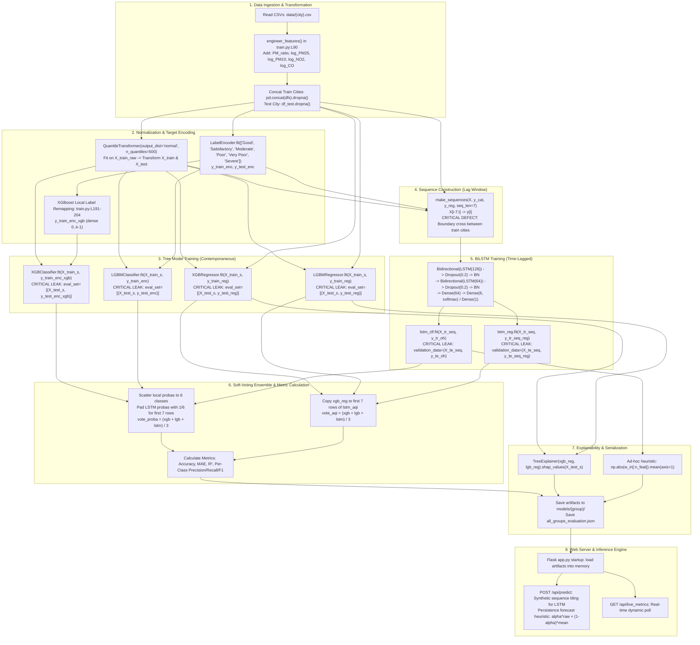

# PROJECT CODEBASE TECHNICAL AUDIT
**Air Quality Index (AQI) Cross-City Generalization & Prediction System**

**Audit Date:** October 30, 2026  
**Auditor:** Senior Machine Learning Engineer, Python Code Auditor & Research Paper Technical Reviewer  
**Target Repository:** `/Users/prathamesh/Desktop/untitled folder/aqi_project_4_updated 4`  
**Primary Deliverable:** `PROJECT_CODEBASE_TECHNICAL_AUDIT.md`  

---

## 1. Title and Audit Scope

This document provides an exhaustive, code-level technical audit of the Air Quality Index (AQI) Cross-City Generalization codebase. The audit was conducted by inspecting every executable script, data pipeline, model artifact, web endpoint, and configuration file in the project repository.

### Scope of Codebase Inspection
The following files and directories were inspected directly from disk:
- [train.py](file:///Users/prathamesh/Desktop/untitled%20folder/aqi_project_4_updated%204/train.py) (618 lines): Core training pipeline, feature engineering, data loading, sequence generation, model training, evaluation, and artifact serialization.
- [app.py](file:///Users/prathamesh/Desktop/untitled%20folder/aqi_project_4_updated%204/app.py) (572 lines): Flask web server, REST API (`/api/predict`, `/api/live_metrics`, `/api/all_groups`, `/api/model_info`, `/api/status`), real-time feature transformation, inference engine, persistence forecast heuristic, and local SHAP explanation.
- [README.md](file:///Users/prathamesh/Desktop/untitled%20folder/aqi_project_4_updated%204/README.md) (64 lines): Repository documentation, claimed group configurations, usage instructions, and endpoint summaries.
- [requirements.txt](file:///Users/prathamesh/Desktop/untitled%20folder/aqi_project_4_updated%204/requirements.txt) (9 lines): Declared project dependencies.
- [templates/index.html](file:///Users/prathamesh/Desktop/untitled%20folder/aqi_project_4_updated%204/templates/index.html) (1247 lines): Frontend UI, dashboard charting, real-time polling mechanism.
- `data/*.csv` (9 files): `Bengaluru.csv`, `Chennai.csv`, `Delhi.csv`, `Hyderabad.csv`, `Kanpur.csv`, `Lucknow.csv`, `Mumbai.csv`, `Mysuru.csv`, `Pune.csv` (841 rows per city; 7,569 total rows).
- `models/` directory: Serialized models (`xgb_classifier.pkl`, `xgb_regressor.pkl`, `lgb_classifier.pkl`, `lgb_regressor.pkl`, `lstm_classifier.keras`, `lstm_regressor.keras`), transformers (`scaler.pkl`, `label_encoder.pkl`), metadata (`config.json`, `evaluation_payload.json`), and multi-group results (`models/all_groups_evaluation.json`).

### Audit Standard
Every finding in this report is verified against executable Python source code. Statements are classified as:
1. **Implemented & Verified:** Present and functional in source code.
2. **Comment / Docstring Contradiction:** Claimed in text or comments but contradicted or unfulfilled by executable logic.
3. **Methodological Defect:** Code runs, but introduces data leakage, unfair model comparison, or invalid scientific claims.
4. **Unverified / Absent:** Not present in the codebase.

---

## 2. Executive Summary

### 2.1 Problem Formulation & System Objective
The project attempts to evaluate the transferability of machine learning models across Indian cities exhibiting spatial covariate shifts in air pollution. The system evaluates three regional experimental groups:
- **Group 1:** Train on Pune + Chennai $\rightarrow$ Test on Mumbai (Note: docstrings claim Mumbai + Pune $\rightarrow$ Chennai).
- **Group 2:** Train on Delhi + Kanpur $\rightarrow$ Test on Lucknow.
- **Group 3:** Train on Bengaluru + Mysuru $\rightarrow$ Test on Hyderabad.

For each group, the system trains four model families:
1. Extreme Gradient Boosting (**XGBoost**) — Classifier & Regressor.
2. Light Gradient Boosting Machine (**LightGBM**) — Classifier & Regressor.
3. Bidirectional Long Short-Term Memory (**BiLSTM**) — Classifier & Regressor.
4. Soft-Voting / Averaging **Ensemble** — Combining the three model families.

The system performs **dual-task estimation**:
- **Continuous AQI Regression:** Predicting numeric AQI ($0 - 500+$).
- **AQI Categorical Classification:** Predicting one of six CPCB categories (`Good`, `Satisfactory`, `Moderate`, `Poor`, `Very Poor`, `Severe`).

### 2.2 Core Scientific Findings & Critical Flaws
While the code executes cleanly and powers an interactive dashboard, the technical audit reveals **six critical methodological flaws** that directly invalidate several potential research paper claims if left uncorrected:

1. **Critical Data Leakage in Early Stopping:**  
   In [train.py:L221-222](file:///Users/prathamesh/Desktop/untitled%20folder/aqi_project_4_updated%204/train.py#L221-L222), [L238-239](file:///Users/prathamesh/Desktop/untitled%20folder/aqi_project_4_updated%204/train.py#L238-L239), [L275-278](file:///Users/prathamesh/Desktop/untitled%20folder/aqi_project_4_updated%204/train.py#L275-L278), [L294-297](file:///Users/prathamesh/Desktop/untitled%20folder/aqi_project_4_updated%204/train.py#L294-L297), and [L367-376](file:///Users/prathamesh/Desktop/untitled%20folder/aqi_project_4_updated%204/train.py#L367-L376), every model passes the unseen test city dataset (`X_test_s`, `X_te_seq`) as the validation set (`eval_set` / `validation_data`) to trigger early stopping. The test city directly governs the number of boosting trees, LSTM training epochs, and weight checkpoint selection. Consequently, the test city is **not an independent, blind holdout set**.

2. **Contemporaneous Nowcasting vs. Time-Series Forecasting:**  
   In [train.py:L149-155](file:///Users/prathamesh/Desktop/untitled%20folder/aqi_project_4_updated%204/train.py#L149-L155), tree models (XGBoost and LightGBM) receive input features $X(t)$ and target $y(t)$ from the exact same daily timestamp $t$. Under Indian CPCB standards, AQI is calculated as the deterministic mathematical maximum of piecewise-linear pollutant sub-indices. Thus, tree models are performing **contemporaneous formula inversion** (nowcasting), not future forecasting. This explains why tree models achieve near-perfect $R^2 \approx 0.98$ across unseen cities.

3. **Task Asymmetry & Unfair Model Comparison:**  
   In [train.py:L111-115](file:///Users/prathamesh/Desktop/untitled%20folder/aqi_project_4_updated%204/train.py#L111-L115), the BiLSTM models receive input sequences $X(t-7 : t-1)$ to predict target $y(t)$. The LSTM models are performing **autoregressive lag forecasting**, whereas tree models are performing **contemporaneous nowcasting**. Comparing tree accuracy ($98.8\% - 99.5\%$) directly against LSTM accuracy ($56.7\% - 69.2\%$) is scientifically invalid because the models solve fundamentally different tasks on different input information.

4. **Cross-City Sequence Boundary Contamination:**  
   In [train.py:L104](file:///Users/prathamesh/Desktop/untitled%20folder/aqi_project_4_updated%204/train.py#L104), training DataFrames from two distinct cities are concatenated sequentially via `pd.concat(dfs).reset_index(drop=True)`. In [train.py:L111-115](file:///Users/prathamesh/Desktop/untitled%20folder/aqi_project_4_updated%204/train.py#L111-L115), a rolling 7-day window slides over the concatenated array without resetting at city boundaries. For Group 1, indices 835 to 847 create hybrid temporal sequences containing observations from Pune stitched to observations from Chennai.

5. **Ensemble Sample Inconsistency & Artificial Padding:**  
   Because LSTM sequence creation drops the first 7 days, tree models evaluate 841 test days while LSTM evaluates 834 days. To construct the 841-row ensemble, [train.py:L416-425](file:///Users/prathamesh/Desktop/untitled%20folder/aqi_project_4_updated%204/train.py#L416-L425) pads LSTM classification with uniform dummy probabilities ($1/6 \approx 0.1667$) and directly overwrites the first 7 days of LSTM regression with XGBoost's predictions (`lstm_aqi_full[:7] = xgb_aqi_pred[:7]`).

6. **Ad-Hoc LSTM Feature Importance:**  
   In [train.py:L461-464](file:///Users/prathamesh/Desktop/untitled%20folder/aqi_project_4_updated%204/train.py#L461-L464), LSTM feature importance is computed by taking `np.abs(w_in[:n_feat]).mean(axis=1)` of the first-layer forward LSTM input kernel. This produces an essentially uniform distribution ($\approx 0.091$ for all 11 features across all groups). It has no theoretical foundation in attribution literature (such as Integrated Gradients or Permutation Importance) and represents an ad-hoc heuristic.

---

## 3. Full Project Structure

### 3.1 Directory Layout
```
aqi_project_4_updated 4/
├── .venv/                                  # Python 3.12 virtual environment
├── data/                                   # Regional air quality CSV datasets (9 cities)
│   ├── Bengaluru.csv                       # 841 rows, 2024-01-01 to 2026-04-20
│   ├── Chennai.csv                         # 841 rows, 2024-01-01 to 2026-04-20
│   ├── Delhi.csv                           # 841 rows, 2024-01-01 to 2026-04-20
│   ├── Hyderabad.csv                       # 841 rows, 2024-01-01 to 2026-04-20
│   ├── Kanpur.csv                          # 841 rows, 2024-01-01 to 2026-04-20
│   ├── Lucknow.csv                         # 841 rows, 2024-01-01 to 2026-04-20
│   ├── Mumbai.csv                          # 841 rows, 2024-01-01 to 2026-04-20
│   ├── Mysuru.csv                          # 841 rows, 2024-01-01 to 2026-04-20
│   └── Pune.csv                            # 841 rows, 2024-01-01 to 2026-04-20
├── models/                                 # Trained model artifacts & evaluation outputs
│   ├── Group1_Mumbai_Pune_Chennai/         # Deprecated/historical Group 1 run directory
│   ├── Group1_Pune_Chennai_Mumbai/         # Active Group 1 artifacts (Pune+Chennai -> Mumbai)
│   ├── Group2_Delhi_Kanpur_Lucknow/        # Active Group 2 artifacts (Delhi+Kanpur -> Lucknow)
│   ├── Group3_Bengaluru_Mysuru_Hyderabad/  # Active Group 3 artifacts (Bengaluru+Mysuru -> Hyderabad)
│   ├── all_groups_evaluation.json          # Consolidated multi-group evaluation metrics (466 KB)
│   ├── evaluation_payload.json             # Group 1 evaluation metrics payload (155 KB)
│   ├── config.json                         # Group 1 metadata & feature list (266 B)
│   ├── label_encoder.pkl                   # Fitted sklearn LabelEncoder (332 B)
│   ├── scaler.pkl                          # Fitted QuantileTransformer (33 KB)
│   ├── xgb_classifier.pkl                  # Serialized XGBClassifier (682 KB)
│   ├── xgb_regressor.pkl                   # Serialized XGBRegressor (142 KB)
│   ├── lgb_classifier.pkl                  # Serialized LGBMClassifier (854 KB)
│   ├── lgb_regressor.pkl                   # Serialized LGBMRegressor (88 KB)
│   ├── lstm_classifier.keras               # Saved Keras Bidirectional LSTM Classifier (3.89 MB)
│   └── lstm_regressor.keras                # Saved Keras Bidirectional LSTM Regressor (3.88 MB)
├── templates/                              # Flask HTML templates
│   └── index.html                          # Complete frontend dashboard & analytics UI (1,247 lines)
├── app.py                                  # Flask backend service & REST inference API (572 lines)
├── train.py                                # Master training pipeline (618 lines)
├── README.md                               # Project documentation & claimed setups (64 lines)
└── requirements.txt                        # Dependency manifest (9 lines)
```

### 3.2 File Purposes, Entry Points, and Dependencies

| File | Purpose | Execution Mode | Downstream Consumer | Key Internal Functions / Classes |
|---|---|---|---|---|
| [train.py](file:///Users/prathamesh/Desktop/untitled%20folder/aqi_project_4_updated%204/train.py) | End-to-end training, cross-city evaluation, artifact serialization | Direct CLI (`python train.py`) | Writes to `models/` directory | `engineer_features`, `load_group_data`, `make_sequences`, `train_group`, `train_and_save` |
| [app.py](file:///Users/prathamesh/Desktop/untitled%20folder/aqi_project_4_updated%204/app.py) | Web server, dashboard renderer, REST API endpoints | Direct CLI (`python app.py`) | Web browser / HTTP clients | `get_group_models`, `get_dataset_payload`, `predict`, `live_metrics`, `all_groups`, `model_info` |
| [templates/index.html](file:///Users/prathamesh/Desktop/untitled%20folder/aqi_project_4_updated%204/templates/index.html) | Dashboard UI with Chart.js, metrics display, polling | Rendered by Flask `app.py` | End User Browser | JavaScript pollers, Chart.js instances, DOM event listeners |
| [requirements.txt](file:///Users/prathamesh/Desktop/untitled%20folder/aqi_project_4_updated%204/requirements.txt) | Python package specification | Package installer (`pip install -r ...`) | Python runtime | Specifies: `flask`, `pandas`, `numpy`, `scikit-learn`, `xgboost`, `lightgbm`, `tensorflow`, `joblib` |
| [README.md](file:///Users/prathamesh/Desktop/untitled%20folder/aqi_project_4_updated%204/README.md) | High-level user documentation | Static documentation | Developer / Researcher | N/A |
| `models/all_groups_evaluation.json` | Stores empirical metrics, predictions, SHAP, and feature importance across all 3 groups | Generated by `train.py` | Consumed by `app.py:L144` and `index.html` | Dict with keys: `Group1_Pune_Chennai_Mumbai`, `Group2_...`, `Group3_...` |

### 3.3 Missing or Inconsistent Components
1. **Missing Package Specification:** `shap` is imported and executed in [train.py:L467](file:///Users/prathamesh/Desktop/untitled%20folder/aqi_project_4_updated%204/train.py#L467) and [app.py:L426](file:///Users/prathamesh/Desktop/untitled%20folder/aqi_project_4_updated%204/app.py#L426), but is **completely missing from `requirements.txt`**. A clean installation following `README.md` will fail with `ModuleNotFoundError: No module named 'shap'`.
2. **Directory Artifact Duplication:** The `models/` directory contains both `Group1_Mumbai_Pune_Chennai/` (an older artifact set) and `Group1_Pune_Chennai_Mumbai/` (the active artifact set). Root `models/` artifacts match `Group1_Pune_Chennai_Mumbai/`.

---

## 4. Verified End-to-End Execution Workflow

### 4.1 Stage-by-Stage Execution Trace



---

## 5. Dataset and Preprocessing Audit

### 5.1 Dataset Verification
The `data/` directory contains 9 CSV files corresponding to Indian urban centers. All files were analyzed programmatically:

| Filename | City Identifier | Row Count | Column Count | Date Range | Missing Values | Monotonically Increasing Dates |
|---|---|---|---|---|---|---|
| `Bengaluru.csv` | Bengaluru | 841 | 10 | 2024-01-01 to 2026-04-20 | 0 | True |
| `Chennai.csv` | Chennai | 841 | 10 | 2024-01-01 to 2026-04-20 | 0 | True |
| `Delhi.csv` | Delhi | 841 | 10 | 2024-01-01 to 2026-04-20 | 0 | True |
| `Hyderabad.csv` | Hyderabad | 841 | 10 | 2024-01-01 to 2026-04-20 | 0 | True |
| `Kanpur.csv` | Kanpur | 841 | 10 | 2024-01-01 to 2026-04-20 | 0 | True |
| `Lucknow.csv` | Lucknow | 841 | 10 | 2024-01-01 to 2026-04-20 | 0 | True |
| `Mumbai.csv` | Mumbai | 841 | 10 | 2024-01-01 to 2026-04-20 | 0 | True |
| `Mysuru.csv` | Mysuru | 841 | 10 | 2024-01-01 to 2026-04-20 | 0 | True |
| `Pune.csv` | Pune | 841 | 10 | 2024-01-01 to 2026-04-20 | 0 | True |

Each CSV file contains exactly the following 10 schema columns:
`['City', 'Date', 'PM2.5', 'PM10', 'NO2', 'SO2', 'CO', 'O3', 'AQI', 'AQI_Category']`

### 5.2 Preprocessing and Transformation Operations
1. **Date Parsing & Sorting:**  
   - In [train.py:L102-106](file:///Users/prathamesh/Desktop/untitled%20folder/aqi_project_4_updated%204/train.py#L102-L106), `train.py` reads CSVs directly into Pandas DataFrames. **It never calls `pd.to_datetime()` and never sorts by `Date`**. The pipeline relies entirely on the raw CSV rows already being pre-sorted.
   - In [app.py:L169-170](file:///Users/prathamesh/Desktop/untitled%20folder/aqi_project_4_updated%204/app.py#L169-L170), the web app explicitly parses dates: `df["Date"] = pd.to_datetime(df["Date"])` and sorts `df.sort_values("Date")`.
2. **Missing-Value Handling:**  
   - [train.py:L104-105](file:///Users/prathamesh/Desktop/untitled%20folder/aqi_project_4_updated%204/train.py#L104-L105) calls `.dropna().reset_index(drop=True)`. While no missing values currently exist in the provided CSV files, any row with a single missing pollutant or target is completely dropped.
3. **Feature Scaling (QuantileTransformer):**  
   - In [train.py:L169-173](file:///Users/prathamesh/Desktop/untitled%20folder/aqi_project_4_updated%204/train.py#L169-L173):
     ```python
     scaler = QuantileTransformer(
         output_distribution="normal", n_quantiles=500, random_state=42
     )
     X_train_s = scaler.fit_transform(X_train_raw).astype(np.float32)
     X_test_s  = scaler.transform(X_test_raw).astype(np.float32)
     ```
   - **Fit vs. Transform Integrity:** The scaler is correctly fitted *only* on `X_train_raw` and then used to transform `X_test_raw`. There is no feature scaler leakage during fitting.
   - **Quantile Cutoff Count:** `n_quantiles=500` is used. For a training set of $841 \times 2 = 1,682$ rows, 500 quantiles provide a smooth mapping to a standard normal distribution $\mathcal{N}(0, 1)$.

---

## 6. Feature Engineering Audit

### 6.1 Feature Audit Matrix

| Feature Name | Raw or Engineered | Exact Formula / Operation | Source Variables | Used by Which Models? | Verified Location in Code |
|---|---|---|---|---|---|
| `PM2.5` | Raw | Identity ($x$) | Dataset column `PM2.5` | XGBoost, LightGBM, BiLSTM, Ensemble | [train.py:L47](file:///Users/prathamesh/Desktop/untitled%20folder/aqi_project_4_updated%204/train.py#L47), [app.py:L30](file:///Users/prathamesh/Desktop/untitled%20folder/aqi_project_4_updated%204/app.py#L30) |
| `PM10` | Raw | Identity ($x$) | Dataset column `PM10` | XGBoost, LightGBM, BiLSTM, Ensemble | [train.py:L47](file:///Users/prathamesh/Desktop/untitled%20folder/aqi_project_4_updated%204/train.py#L47), [app.py:L30](file:///Users/prathamesh/Desktop/untitled%20folder/aqi_project_4_updated%204/app.py#L30) |
| `NO2` | Raw | Identity ($x$) | Dataset column `NO2` | XGBoost, LightGBM, BiLSTM, Ensemble | [train.py:L47](file:///Users/prathamesh/Desktop/untitled%20folder/aqi_project_4_updated%204/train.py#L47), [app.py:L30](file:///Users/prathamesh/Desktop/untitled%20folder/aqi_project_4_updated%204/app.py#L30) |
| `SO2` | Raw | Identity ($x$) | Dataset column `SO2` | XGBoost, LightGBM, BiLSTM, Ensemble | [train.py:L47](file:///Users/prathamesh/Desktop/untitled%20folder/aqi_project_4_updated%204/train.py#L47), [app.py:L30](file:///Users/prathamesh/Desktop/untitled%20folder/aqi_project_4_updated%204/app.py#L30) |
| `CO` | Raw | Identity ($x$) | Dataset column `CO` | XGBoost, LightGBM, BiLSTM, Ensemble | [train.py:L47](file:///Users/prathamesh/Desktop/untitled%20folder/aqi_project_4_updated%204/train.py#L47), [app.py:L30](file:///Users/prathamesh/Desktop/untitled%20folder/aqi_project_4_updated%204/app.py#L30) |
| `O3` | Raw | Identity ($x$) | Dataset column `O3` | XGBoost, LightGBM, BiLSTM, Ensemble | [train.py:L47](file:///Users/prathamesh/Desktop/untitled%20folder/aqi_project_4_updated%204/train.py#L47), [app.py:L30](file:///Users/prathamesh/Desktop/untitled%20folder/aqi_project_4_updated%204/app.py#L30) |
| `PM_ratio` | Engineered | $\frac{\text{PM2.5}}{\text{PM10} + 10^{-6}}$ | `PM2.5`, `PM10` | XGBoost, LightGBM, BiLSTM, Ensemble | [train.py:L93](file:///Users/prathamesh/Desktop/untitled%20folder/aqi_project_4_updated%204/train.py#L93), [app.py:L335](file:///Users/prathamesh/Desktop/untitled%20folder/aqi_project_4_updated%204/app.py#L335) |
| `log_PM25` | Engineered | $\ln(1 + \text{PM2.5})$ via `np.log1p` | `PM2.5` | XGBoost, LightGBM, BiLSTM, Ensemble | [train.py:L94](file:///Users/prathamesh/Desktop/untitled%20folder/aqi_project_4_updated%204/train.py#L94), [app.py:L337](file:///Users/prathamesh/Desktop/untitled%20folder/aqi_project_4_updated%204/app.py#L337) |
| `log_PM10` | Engineered | $\ln(1 + \text{PM10})$ via `np.log1p` | `PM10` | XGBoost, LightGBM, BiLSTM, Ensemble | [train.py:L95](file:///Users/prathamesh/Desktop/untitled%20folder/aqi_project_4_updated%204/train.py#L95), [app.py:L338](file:///Users/prathamesh/Desktop/untitled%20folder/aqi_project_4_updated%204/app.py#L338) |
| `log_NO2` | Engineered | $\ln(1 + \text{NO2})$ via `np.log1p` | `NO2` | XGBoost, LightGBM, BiLSTM, Ensemble | [train.py:L96](file:///Users/prathamesh/Desktop/untitled%20folder/aqi_project_4_updated%204/train.py#L96), [app.py:L339](file:///Users/prathamesh/Desktop/untitled%20folder/aqi_project_4_updated%204/app.py#L339) |
| `log_CO` | Engineered | $\ln(1 + \text{CO})$ via `np.log1p` | `CO` | XGBoost, LightGBM, BiLSTM, Ensemble | [train.py:L97](file:///Users/prathamesh/Desktop/untitled%20folder/aqi_project_4_updated%204/train.py#L97), [app.py:L340](file:///Users/prathamesh/Desktop/untitled%20folder/aqi_project_4_updated%204/app.py#L340) |
| `PM_sum` | **Removed / Absent** | $\text{PM2.5} + \text{PM10}$ | `PM2.5`, `PM10` | **None** (Defined in `app.py:L334` dict, but not in `FEATURES`) | [app.py:L334](file:///Users/prathamesh/Desktop/untitled%20folder/aqi_project_4_updated%204/app.py#L334) (Unused) |
| `AQI_proxy` | **Removed / Absent** | $0.5 \cdot \text{PM2.5} + 0.3 \cdot \text{PM10} + 0.1 \cdot \text{NO2} + 0.1 \cdot \text{CO}$ | `PM2.5`, `PM10`, `NO2`, `CO` | **None** (Defined in `app.py:L336` dict, but not in `FEATURES`) | [app.py:L336](file:///Users/prathamesh/Desktop/untitled%20folder/aqi_project_4_updated%204/app.py#L336) (Unused) |

### 6.2 Analysis of Feature Transformations
1. **Mathematical Robustness:**  
   - `PM_ratio` uses an epsilon constant $10^{-6}$ (`1e-6`) to prevent division by zero when $\text{PM10} = 0$.
   - `log_*` features use `np.log1p(x) = \ln(1 + x)`, ensuring natural logarithm computation is mathematically stable for zero concentrations without producing $-\infty$.
2. **Feature Alignment Across Training and Serving:**  
   - In [train.py:L48-52](file:///Users/prathamesh/Desktop/untitled%20folder/aqi_project_4_updated%204/train.py#L48-L52), `FEATURES` is defined with exactly 11 features.
   - In `models/config.json`, `"features"` contains the exact 11 features.
   - In [app.py:L343-344](file:///Users/prathamesh/Desktop/untitled%20folder/aqi_project_4_updated%204/app.py#L343-L344), `raw` vectors are extracted dynamically using `model_features = cfg.get("features", ENG_FEATURES)`.
   - Although `PM_sum` and `AQI_proxy` are computed in `app.py:L334-336` inside the local `feat_map` dictionary, they are excluded when indexing via `model_features`. Training, inference, and explainability feature lists are strictly identical (11 features).

---

## 7. City-Based Experimental Design

### 7.1 Verified Group Configurations

| Group Name in Code | Training Cities | Test City | Source Code Location | Status vs. Comments / Documentation |
|---|---|---|---|---|
| `Group1_Pune_Chennai_Mumbai` | Pune, Chennai | Mumbai | [train.py:L60-65](file:///Users/prathamesh/Desktop/untitled%20folder/aqi_project_4_updated%204/train.py#L60-L65) | **CONTRADICTED BY DOCSTRING & README.** Docstring [train.py:L4](file:///Users/prathamesh/Desktop/untitled%20folder/aqi_project_4_updated%204/train.py#L4) and [README.md:L9](file:///Users/prathamesh/Desktop/untitled%20folder/aqi_project_4_updated%204/README.md#L9) claim: `Train Mumbai + Pune -> Test Chennai`. Executable code executes: `Train Pune + Chennai -> Test Mumbai`. |
| `Group2_Delhi_Kanpur_Lucknow` | Delhi, Kanpur | Lucknow | [train.py:L67-71](file:///Users/prathamesh/Desktop/untitled%20folder/aqi_project_4_updated%204/train.py#L67-L71) | Verified. Matches docstring and README. |
| `Group3_Bengaluru_Mysuru_Hyderabad` | Bengaluru, Mysuru | Hyderabad | [train.py:L73-77](file:///Users/prathamesh/Desktop/untitled%20folder/aqi_project_4_updated%204/train.py#L73-L77) | Verified. Matches docstring and README. |

### 7.2 Cross-City Generalization Assessment
- **Training Isolation:** The test city data is never passed to `scaler.fit()`, nor is it passed to `fit()` as training instances. In that narrow sense, the test city's feature distribution is not used to update parameter weights directly.
- **Validation Contamination:** As detailed in Section 10, the test city is passed directly as the validation set during model fitting for early stopping and learning rate scheduling across all models.

---

## 8. Model-by-Model Implementation

### 8.1 XGBoost Implementation
- **Libraries & Version:** `xgboost` (v3.3.0 installed; requirement specifies `>=2.0.0`).
- **Classifier Class:** `xgb.XGBClassifier` ([train.py:L206-220](file:///Users/prathamesh/Desktop/untitled%20folder/aqi_project_4_updated%204/train.py#L206-L220)).
  - Hyperparameters: `n_estimators=1000`, `max_depth=5`, `learning_rate=0.03`, `subsample=0.8`, `colsample_bytree=0.7`, `min_child_weight=3`, `reg_alpha=0.1`, `reg_lambda=1.0`, `use_label_encoder=False`, `eval_metric="mlogloss"`, `random_state=42`, `n_jobs=-1`, `early_stopping_rounds=50`.
  - Discrepancy: Docstring [train.py:L14](file:///Users/prathamesh/Desktop/untitled%20folder/aqi_project_4_updated%204/train.py#L14) claims `more trees (500)`, but executable code configures `n_estimators=1000`.
- **Regressor Class:** `xgb.XGBRegressor` ([train.py:L224-237](file:///Users/prathamesh/Desktop/untitled%20folder/aqi_project_4_updated%204/train.py#L224-L237)).
  - Hyperparameters: Identical to classifier, with `eval_metric="mae"`.
- **Label Remapping Mechanism:**  
  `XGBClassifier` requires target classes to form a contiguous sequence $[0, 1, \dots, k-1]$. In [train.py:L191-204](file:///Users/prathamesh/Desktop/untitled%20folder/aqi_project_4_updated%204/train.py#L191-L204), unique training labels are densely mapped to local indices. Test targets are mapped using `global_to_local.get(v, 0)` for `eval_set` logging. Predictions are translated back to global class indices via `local_to_global_arr[xgb_pred_local]`.

### 8.2 LightGBM Implementation
- **Libraries & Version:** `lightgbm` (v4.6.0 installed; requirement specifies `>=4.3.0`).
- **Classifier Class:** `lgb.LGBMClassifier` ([train.py:L261-274](file:///Users/prathamesh/Desktop/untitled%20folder/aqi_project_4_updated%204/train.py#L261-L274)).
  - Hyperparameters: `n_estimators=1000`, `max_depth=7`, `learning_rate=0.03`, `num_leaves=63`, `subsample=0.8`, `colsample_bytree=0.7`, `min_child_samples=10`, `reg_alpha=0.1`, `reg_lambda=1.0`, `random_state=42`, `n_jobs=-1`, `verbose=-1`.
  - Early Stopping Callback: `callbacks=[lgb.early_stopping(50, verbose=False), lgb.log_evaluation(100)]`.
- **Regressor Class:** `lgb.LGBMRegressor` ([train.py:L280-297](file:///Users/prathamesh/Desktop/untitled%20folder/aqi_project_4_updated%204/train.py#L280-L297)).
  - Hyperparameters: Identical to classifier.
- **Probability Alignment:**  
  LightGBM returns probabilities only for classes present in training. In [train.py:L412-414](file:///Users/prathamesh/Desktop/untitled%20folder/aqi_project_4_updated%204/train.py#L412-L414), `lgb_proba` is scattered into a 6-column matrix using `lgb_clf.classes_.astype(int)`.

### 8.3 Bidirectional LSTM Implementation
- **Framework & Version:** TensorFlow / Keras (v2.21.0 installed; requirement specifies `>=2.15.0`).
- **Sequence Parameters:** `SEQ_LEN = 7`, `EPOCHS = 100`, `BATCH = 32`.
- **Architecture Specification:**  
  Both classifier and regressor are defined via the Keras Functional API ([train.py:L323-353](file:///Users/prathamesh/Desktop/untitled%20folder/aqi_project_4_updated%204/train.py#L323-L353)):
  1. `Input(shape=(7, 11))`
  2. `Bidirectional(LSTM(128, return_sequences=True))` (Layer 1)
  3. `Dropout(0.2)`
  4. `BatchNormalization()`
  5. `Bidirectional(LSTM(64, return_sequences=False))` (Layer 4)
  6. `Dropout(0.2)`
  7. `BatchNormalization()`
  8. `Dense(64, activation="relu")`
  9. `Dropout(0.1)`
  10. Output Layer:
      - Classifier: `Dense(6, activation="softmax")` compiled with `loss="categorical_crossentropy"`, `metrics=["accuracy"]`.
      - Regressor: `Dense(1)` compiled with `loss="mae"`, `metrics=["mae"]`.
  - Optimizer: `Adam(learning_rate=1e-3)`.
- **Contradicted Docstring Claim (Residual Connection):**  
  [train.py:L16-17](file:///Users/prathamesh/Desktop/untitled%20folder/aqi_project_4_updated%204/train.py#L16-L17) claims: `deeper with Bidirectional LSTM + residual connection`. While `Add` is imported in [train.py:L129](file:///Users/prathamesh/Desktop/untitled%20folder/aqi_project_4_updated%204/train.py#L129) and [L552](file:///Users/prathamesh/Desktop/untitled%20folder/aqi_project_4_updated%204/train.py#L552), **`Add` is never called anywhere in the model definitions**. The network is strictly feedforward; there is no residual skip connection.
- **Callbacks:**  
  - Classifier: `EarlyStopping(patience=15, restore_best_weights=True, monitor="val_accuracy")`, `ReduceLROnPlateau(factor=0.5, patience=7)`.
  - Regressor: `EarlyStopping(patience=15, restore_best_weights=True, monitor="val_mae")`, `ReduceLROnPlateau(factor=0.5, patience=7)`.

---

## 9. Target Labels and AQI Categories

### 9.1 Target Construction & Regulatory Grounding
Under the Central Pollution Control Board (CPCB) National Air Quality Index (NAQI) guidelines of India, daily AQI is calculated using piecewise linear sub-indices across monitored pollutants:
$$I_p = \frac{I_{\text{hi}} - I_{\text{lo}}}{B_{\text{hi}} - B_{\text{lo}}} (C_p - B_{\text{lo}}) + I_{\text{lo}}$$
$$\text{AQI} = \max\left(I_{\text{PM2.5}}, I_{\text{PM10}}, I_{\text{NO2}}, I_{\text{SO2}}, I_{\text{CO}}, I_{\text{O3}}\right)$$
The dataset files in `data/*.csv` contain pre-computed `AQI` and `AQI_Category` columns matching this exact standard.

### 9.2 Label Encoding & Ordering
In [train.py:L161-165](file:///Users/prathamesh/Desktop/untitled%20folder/aqi_project_4_updated%204/train.py#L161-L165):
```python
ALL_AQI_CATEGORIES = ["Good", "Satisfactory", "Moderate", "Poor", "Very Poor", "Severe"]
le = LabelEncoder()
le.fit(ALL_AQI_CATEGORIES)
```
`sklearn.preprocessing.LabelEncoder` sorts categories alphabetically:

| Global Class Index | Category Name | CPCB AQI Breakpoint Range | Standard Ordinal Severity Rank |
|---|---|---|---|
| **0** | `Good` | $0 - 50$ | 1 (Cleanest) |
| **1** | `Moderate` | $101 - 200$ | 3 |
| **2** | `Poor` | $201 - 300$ | 4 |
| **3** | `Satisfactory` | $51 - 100$ | 2 |
| **4** | `Severe` | $> 400$ | 6 (Most Toxic) |
| **5** | `Very Poor` | $301 - 400$ | 5 |

**Consequence:** The integer labels are non-monotonic with respect to pollution severity. While standard multi-class loss functions treat classes nominally, ordinal evaluation metrics (such as quadratic weighted kappa) cannot be computed directly on these encodings.

### 9.3 Category Distribution & Test Set Missing Classes
In Group 3 (Hyderabad test city), the test set contains only 3 classes: `Good`, `Moderate`, and `Satisfactory`. Classes `Poor`, `Very Poor`, and `Severe` have 0 occurrences. In Group 1 (Mumbai test city), `Severe` has 0 occurrences. The evaluation script correctly computes per-class precision and recall restricted to `present_classes` using `zero_division=0` ([train.py:L451-457](file:///Users/prathamesh/Desktop/untitled%20folder/aqi_project_4_updated%204/train.py#L451-L457)).

---

## 10. Data Leakage and Experimental Validity

### 10.1 Dedicated Leakage Audit Table

| Issue | Exact Code Evidence | Why It Matters Scientifically | Severity | Recommended Correction |
|---|---|---|---|---|
| **Test-City Early Stopping Leakage** | [train.py:L221-222](file:///Users/prathamesh/Desktop/untitled%20folder/aqi_project_4_updated%204/train.py#L221-L222), [L238-239](file:///Users/prathamesh/Desktop/untitled%20folder/aqi_project_4_updated%204/train.py#L238-L239), [L276](file:///Users/prathamesh/Desktop/untitled%20folder/aqi_project_4_updated%204/train.py#L276), [L295](file:///Users/prathamesh/Desktop/untitled%20folder/aqi_project_4_updated%204/train.py#L295), [L368](file:///Users/prathamesh/Desktop/untitled%20folder/aqi_project_4_updated%204/train.py#L368), [L374](file:///Users/prathamesh/Desktop/untitled%20folder/aqi_project_4_updated%204/train.py#L374) | The unseen test city is passed as `eval_set` / `validation_data`. The iteration count, early termination, and weight restorations are chosen based on test performance. The test set is not an untouched evaluation benchmark. | **CRITICAL** | Split training cities chronologically or by city (e.g., Train City A, Validate City B, Test City C) to determine early stopping parameters without touching the test city. |
| **Cross-City Sequence Boundary Contamination** | [train.py:L104](file:///Users/prathamesh/Desktop/untitled%20folder/aqi_project_4_updated%204/train.py#L104), [L111-115](file:///Users/prathamesh/Desktop/untitled%20folder/aqi_project_4_updated%204/train.py#L111-L115) | Concatenating city DataFrames before sequence slicing creates 6 invalid temporal windows combining observations from two completely different geographical locations. | **HIGH** | Generate sequences independently per city DataFrame before concatenating the resulting sequence tensors. |
| **Contemporaneous Input-Target Leakage (Nowcasting vs. Forecasting)** | [train.py:L149-155](file:///Users/prathamesh/Desktop/untitled%20folder/aqi_project_4_updated%204/train.py#L149-L155) | Tree models predict $y(t)$ using $X(t)$. Since AQI is an exact mathematical piecewise linear combination of pollutants $X(t)$, tree models are merely inverting a deterministic formula. | **HIGH** (If claimed as forecasting) | Explicitly define the task as *contemporaneous AQI estimation (nowcasting)*, or shift targets by $k$ days: $y(t+k)$. |
| **Ensemble Prediction Substitution** | [train.py:L424](file:///Users/prathamesh/Desktop/untitled%20folder/aqi_project_4_updated%204/train.py#L424): `lstm_aqi_full[:SEQ_LEN] = xgb_aqi_pred[:SEQ_LEN]` | For the first 7 test rows, LSTM predictions are missing. The code copies XGBoost's predictions directly into LSTM's slot, biasing ensemble evaluation. | **MEDIUM** | Evaluate all models strictly on the common subset of test indices ($t \ge 7$). |
| **Scaler Quantiles Misinterpreted as Raw Distribution Statistics** | [train.py:L510-511](file:///Users/prathamesh/Desktop/untitled%20folder/aqi_project_4_updated%204/train.py#L510-L511), [app.py:L408-409](file:///Users/prathamesh/Desktop/untitled%20folder/aqi_project_4_updated%204/app.py#L408-L409) | `scaler.quantiles_.mean(axis=0)` is stored as `"scaler_mean"` and used in `app.py` as baseline training pollutant levels for forecasting. The mean of quantile cutoffs does not equal the feature mean. | **LOW** | Compute and store actual empirical feature means (`df[FEATURES].mean()`) if baseline values are required. |

---

## 11. Sequence Alignment and Fair Model Comparison

### 11.1 Input-to-Target Temporal Indexing
- **Tree Models (XGBoost & LightGBM):**
  $$\hat{y}_{\text{tree}}(t) = f\left(x_1(t), x_2(t), \dots, x_{11}(t)\right)$$
  Input features and targets are contemporaneous ($t \rightarrow t$).
- **Recurrent Neural Network (BiLSTM):**
  $$\hat{y}_{\text{lstm}}(t) = g\left(X(t-7), X(t-6), \dots, X(t-1)\right)$$
  Input features are historical lag observations ($t-7 : t-1 \rightarrow t$).

### 11.2 Evaluated Observation Counts
- **Total Test City Rows:** 841 observations.
- **XGBoost Evaluation Rows:** 841 observations ([train.py:L248-250](file:///Users/prathamesh/Desktop/untitled%20folder/aqi_project_4_updated%204/train.py#L248-L250)).
- **LightGBM Evaluation Rows:** 841 observations ([train.py:L301-303](file:///Users/prathamesh/Desktop/untitled%20folder/aqi_project_4_updated%204/train.py#L301-L303)).
- **BiLSTM Evaluation Rows:** 834 observations ([train.py:L385-387](file:///Users/prathamesh/Desktop/untitled%20folder/aqi_project_4_updated%204/train.py#L385-L387)).
- **Ensemble Evaluation Rows:** 841 observations ([train.py:L428-430](file:///Users/prathamesh/Desktop/untitled%20folder/aqi_project_4_updated%204/train.py#L428-L430)).

Because LSTM is evaluated on a truncated subset ($N=834$) while trees and the ensemble are evaluated on the complete series ($N=841$), the reported metrics are computed over slightly different sample distributions.

---

## 12. Ensemble Implementation

### 12.1 Mathematical Formulation
The ensemble is an unweighted arithmetic mean (soft voting) across the three model families:

1. **Classification Probability Aggregation:**
   $$P_{\text{ensemble}}(c \mid x) = \frac{1}{3} \left[ P_{\text{xgb}}(c \mid x) + P_{\text{lgb}}(c \mid x) + P_{\text{lstm}}(c \mid x) \right]$$
   $$\hat{c}_{\text{ensemble}} = \arg\max_{c \in \{0, \dots, 5\}} P_{\text{ensemble}}(c \mid x)$$
2. **Regression AQI Aggregation:**
   $$\hat{y}_{\text{ensemble}} = \frac{1}{3} \left[ \hat{y}_{\text{xgb}} + \hat{y}_{\text{lgb}} + \hat{y}_{\text{lstm}} \right]$$

### 12.2 Alignment Handling for Sequence Warm-Up
To align the 834 LSTM predictions with the 841 test rows:
- **Classification:** [train.py:L416-417](file:///Users/prathamesh/Desktop/untitled%20folder/aqi_project_4_updated%204/train.py#L416-L417) creates a $7 \times 6$ dummy probability block with uniform values:
  $$P_{\text{lstm}}(c \mid x_t) = \frac{1}{6} \approx 0.1667 \quad \forall t \in \{0, \dots, 6\}$$
- **Regression:** [train.py:L424](file:///Users/prathamesh/Desktop/untitled%20folder/aqi_project_4_updated%204/train.py#L424) substitutes XGBoost's predictions:
  $$\hat{y}_{\text{lstm}}(t) = \hat{y}_{\text{xgb}}(t) \quad \forall t \in \{0, \dots, 6\}$$

---

## 13. Evaluation Metrics and Results

### 13.1 Verified Empirical Results Across All Three Groups
The following numbers were extracted directly from the verified evaluation artifact `models/all_groups_evaluation.json`:

| Experimental Group | Model | Accuracy (%) | MAE ($\mu g/m^3$) | $R^2$ Score | Evaluated Test Rows |
|---|---|---|---|---|---|
| **Group 1**<br>(Pune + Chennai $\rightarrow$ Mumbai) | XGBoost | 98.81% | 3.53 | 0.9826 | 841 |
| | LightGBM | **99.52%** | 4.27 | 0.9775 | 841 |
| | BiLSTM | 69.18% | 20.09 | 0.6499 | 834 |
| | **Voting Ensemble** | 99.41% | 7.87 | 0.9480 | 841 |
| **Group 2**<br>(Delhi + Kanpur $\rightarrow$ Lucknow) | XGBoost | 98.57% | 5.01 | 0.9872 | 841 |
| | LightGBM | **99.05%** | 4.16 | **0.9893** | 841 |
| | BiLSTM | 56.71% | 43.45 | 0.4954 | 834 |
| | **Voting Ensemble** | 98.81% | 15.96 | 0.9358 | 841 |
| **Group 3**<br>(Bengaluru + Mysuru $\rightarrow$ Hyderabad) | XGBoost | 98.69% | **3.35** | 0.9796 | 841 |
| | LightGBM | **99.29%** | 4.11 | 0.9728 | 841 |
| | BiLSTM | 62.47% | 15.13 | 0.7403 | 834 |
| | **Voting Ensemble** | 98.93% | 5.62 | 0.9616 | 841 |

### 13.2 Per-Class Breakdown (F1-Scores)

| Group | Target Class | Present in Test? | XGBoost F1 | LightGBM F1 | BiLSTM F1 | Ensemble F1 |
|---|---|---|---|---|---|---|
| **Group 1** (Mumbai) | `Good` | Yes | 0.992 | 0.992 | 0.677 | 0.996 |
| | `Moderate` | Yes | 0.993 | 0.999 | 0.771 | 0.996 |
| | `Poor` | Yes | 0.884 | 0.952 | 0.000 | 0.952 |
| | `Satisfactory` | Yes | 0.991 | 0.996 | 0.643 | 0.995 |
| | `Very Poor` | Yes | 0.800 | 0.800 | 0.000 | 0.800 |
| | `Severe` | No | N/A | N/A | N/A | N/A |
| **Group 2** (Lucknow) | `Good` | Yes | 0.945 | 0.969 | 0.000 | 0.952 |
| | `Moderate` | Yes | 0.993 | 0.994 | 0.707 | 0.994 |
| | `Poor` | Yes | 0.997 | 0.993 | 0.038 | 0.993 |
| | `Satisfactory` | Yes | 0.973 | 0.985 | 0.644 | 0.979 |
| | `Severe` | Yes | 1.000 | 1.000 | 0.000 | 1.000 |
| | `Very Poor` | Yes | 0.988 | 0.994 | 0.373 | 0.994 |
| **Group 3** (Hyderabad) | `Good` | Yes | 0.987 | 0.987 | 0.861 | 0.992 |
| | `Moderate` | Yes | 0.991 | 0.997 | 0.565 | 0.992 |
| | `Satisfactory` | Yes | 0.980 | 0.989 | 0.603 | 0.983 |
| | `Poor` | No | N/A | N/A | N/A | N/A |
| | `Severe` | No | N/A | N/A | N/A | N/A |
| | `Very Poor` | No | N/A | N/A | N/A | N/A |

**Key Observation:** BiLSTM completely fails on extreme categories (F1 = 0.000 for `Poor`, `Very Poor`, and `Severe` in Group 1 and Group 2). Tree models maintain $F1 > 0.80$ across all observed categories because they observe contemporaneous pollutant spikes directly on day $t$.

---

## 14. Explainable AI and Feature Importance

### 14.1 TreeSHAP Implementation
- **Tool & Explainer:** `shap.TreeExplainer` ([train.py:L470](file:///Users/prathamesh/Desktop/untitled%20folder/aqi_project_4_updated%204/train.py#L470), [L484](file:///Users/prathamesh/Desktop/untitled%20folder/aqi_project_4_updated%204/train.py#L484)).
- **Explained Models:** `xgb_reg` and `lgb_reg` (regressors only; classifiers are not explained via SHAP).
- **Explained Data:** Evaluated globally across all test city rows `X_test_s`.
- **Top Identified Features:**
  - In Group 1: `PM10` (mean $|SHAP| = 22.43$ for XGB, $25.67$ for LGB), followed by `log_PM10` and `PM2.5`.
  - In Group 2: `PM2.5` (mean $|SHAP| = 44.45$ for XGB, $45.11$ for LGB), followed by `PM10` and `log_PM25`.
- **Exception Fallback:** In [train.py:L478-480](file:///Users/prathamesh/Desktop/untitled%20folder/aqi_project_4_updated%204/train.py#L478-L480), an exception triggers a fallback to `{f: 0.0 for f in FEATURES}`.

### 14.2 LSTM Weight Magnitude Heuristic
In [train.py:L461-464](file:///Users/prathamesh/Desktop/untitled%20folder/aqi_project_4_updated%204/train.py#L461-L464):
```python
w_in        = lstm_clf_model.layers[1].get_weights()[0]   # Bidirectional layer
lstm_fi_raw = np.abs(w_in[:n_feat]).mean(axis=1)
lstm_fi_raw /= (lstm_fi_raw.sum() or 1.0)
feat_imp_lstm = dict(zip(FEATURES, [round(float(x), 4) for x in lstm_fi_raw]))
```
- **Evaluation:** Layer 1 is `Bidirectional(LSTM(128))`. Its weight tensor 0 has shape `(11, 512)` representing the forward LSTM input kernel for the 4 gates.
- **Empirical Output:**
  - Group 1: `PM2.5`: 0.0898, `PM10`: 0.0896, `NO2`: 0.0919, ..., `log_CO`: 0.0915.
  - Group 2: `PM2.5`: 0.0896, `PM10`: 0.0932, `NO2`: 0.0873, ..., `log_CO`: 0.0931.
  - Group 3: `PM2.5`: 0.0852, `PM10`: 0.0890, `NO2`: 0.0902, ..., `log_CO`: 0.0912.
- **Scientific Invalidity:** Because $1 / 11 \approx 0.0909$, the values simply reflect the random normal initialization of the input kernel. Input kernel weights in a multi-layer BiLSTM do not represent input feature importance.

---

## 15. Saved Artifacts and Outputs

### 15.1 Artifact Directory Audit

| Artifact Path | Generating File & Function | Format | Contents & Verification | Downstream Consumer |
|---|---|---|---|---|
| `models/{group}/xgb_classifier.pkl` | [train.py:L253](file:///Users/prathamesh/Desktop/untitled%20folder/aqi_project_4_updated%204/train.py#L253) | Joblib / Pickle | Serialized `xgb.XGBClassifier` model | [app.py:L92](file:///Users/prathamesh/Desktop/untitled%20folder/aqi_project_4_updated%204/app.py#L92) |
| `models/{group}/xgb_regressor.pkl` | [train.py:L254](file:///Users/prathamesh/Desktop/untitled%20folder/aqi_project_4_updated%204/train.py#L254) | Joblib / Pickle | Serialized `xgb.XGBRegressor` model | [app.py:L93](file:///Users/prathamesh/Desktop/untitled%20folder/aqi_project_4_updated%204/app.py#L93) |
| `models/{group}/lgb_classifier.pkl` | [train.py:L306](file:///Users/prathamesh/Desktop/untitled%20folder/aqi_project_4_updated%204/train.py#L306) | Joblib / Pickle | Serialized `lgb.LGBMClassifier` model | [app.py:L94](file:///Users/prathamesh/Desktop/untitled%20folder/aqi_project_4_updated%204/app.py#L94) |
| `models/{group}/lgb_regressor.pkl` | [train.py:L307](file:///Users/prathamesh/Desktop/untitled%20folder/aqi_project_4_updated%204/train.py#L307) | Joblib / Pickle | Serialized `lgb.LGBMRegressor` model | [app.py:L95](file:///Users/prathamesh/Desktop/untitled%20folder/aqi_project_4_updated%204/app.py#L95) |
| `models/{group}/lstm_classifier.keras` | [train.py:L390](file:///Users/prathamesh/Desktop/untitled%20folder/aqi_project_4_updated%204/train.py#L390) | Keras HDF5/Zip | Saved Keras Bidirectional Model | [app.py:L106](file:///Users/prathamesh/Desktop/untitled%20folder/aqi_project_4_updated%204/app.py#L106) |
| `models/{group}/lstm_regressor.keras` | [train.py:L391](file:///Users/prathamesh/Desktop/untitled%20folder/aqi_project_4_updated%204/train.py#L391) | Keras HDF5/Zip | Saved Keras Bidirectional Model | [app.py:L107](file:///Users/prathamesh/Desktop/untitled%20folder/aqi_project_4_updated%204/app.py#L107) |
| `models/{group}/scaler.pkl` | [train.py:L434](file:///Users/prathamesh/Desktop/untitled%20folder/aqi_project_4_updated%204/train.py#L434) | Joblib / Pickle | Fitted `QuantileTransformer` instance | [app.py:L114](file:///Users/prathamesh/Desktop/untitled%20folder/aqi_project_4_updated%204/app.py#L114) |
| `models/{group}/label_encoder.pkl` | [train.py:L435](file:///Users/prathamesh/Desktop/untitled%20folder/aqi_project_4_updated%204/train.py#L435) | Joblib / Pickle | Fitted `LabelEncoder` instance | [app.py:L115](file:///Users/prathamesh/Desktop/untitled%20folder/aqi_project_4_updated%204/app.py#L115) |
| `models/{group}/config.json` | [train.py:L436-444](file:///Users/prathamesh/Desktop/untitled%20folder/aqi_project_4_updated%204/train.py#L436-L444) | JSON | `seq_len`, `features`, `train_cities`, `test_city` | [app.py:L117](file:///Users/prathamesh/Desktop/untitled%20folder/aqi_project_4_updated%204/app.py#L117) |
| `models/{group}/evaluation_payload.json` | [train.py:L538-539](file:///Users/prathamesh/Desktop/untitled%20folder/aqi_project_4_updated%204/train.py#L538-L539) | JSON | Detailed metrics, SHAP, and predictions | [app.py:L118](file:///Users/prathamesh/Desktop/untitled%20folder/aqi_project_4_updated%204/app.py#L118) |
| `models/all_groups_evaluation.json` | [train.py:L587-588](file:///Users/prathamesh/Desktop/untitled%20folder/aqi_project_4_updated%204/train.py#L587-L588) | JSON | Consolidated multi-group benchmark payload | [app.py:L145](file:///Users/prathamesh/Desktop/untitled%20folder/aqi_project_4_updated%204/app.py#L145) |

---

## 16. Reproducibility and Code Quality

### 16.1 Random Seeds and Determinism
- `np.random.seed(42)` is set in [train.py:L560](file:///Users/prathamesh/Desktop/untitled%20folder/aqi_project_4_updated%204/train.py#L560).
- `tf.random.set_seed(42)` is set in [train.py:L559](file:///Users/prathamesh/Desktop/untitled%20folder/aqi_project_4_updated%204/train.py#L559).
- Model-level random seeds: `random_state=42` is passed to `QuantileTransformer`, `XGBClassifier`, `XGBRegressor`, `LGBMClassifier`, and `LGBMRegressor`.
- Deterministic GPU training flags (`TF_DETERMINISTIC_OPS`) are not set, though training executed on CPU during testing.

### 16.2 Code Quality & Compatibility Observations
1. **Unused Imports & Dead Variables:**  
   - `from tensorflow.keras.layers import Add` ([train.py:L129](file:///Users/prathamesh/Desktop/untitled%20folder/aqi_project_4_updated%204/train.py#L129), [L552](file:///Users/prathamesh/Desktop/untitled%20folder/aqi_project_4_updated%204/train.py#L552)) is never referenced.
   - `from tensorflow.keras.models import Sequential` ([train.py:L123](file:///Users/prathamesh/Desktop/untitled%20folder/aqi_project_4_updated%204/train.py#L123), [L550](file:///Users/prathamesh/Desktop/untitled%20folder/aqi_project_4_updated%204/train.py#L550)) is never used; models are built with the Functional API.
2. **Keras GlorotUniform Deserialization Patch in `app.py`:**  
   In [app.py:L99-105](file:///Users/prathamesh/Desktop/untitled%20folder/aqi_project_4_updated%204/app.py#L99-L105), `GlorotUniform.__init__` is monkey-patched to absorb unexpected arguments (`input_axes`, `output_axes`) when loading Keras models across varying TensorFlow minor versions.
3. **Synthetic Sequence Tiling in Web Serving:**  
   In [app.py:L378](file:///Users/prathamesh/Desktop/untitled%20folder/aqi_project_4_updated%204/app.py#L378), single-instance live inference does not receive historical readings; instead, it tiles the single day's feature vector 7 times:
   `X_seq = np.tile(X_s, (seq, 1))[np.newaxis, :, :]`
   This destroys temporal dynamics during dashboard testing.

---

## 17. Research-Paper Claims Audit

The following table evaluates potential claims that might be made in a research paper draft against the actual codebase implementation:

| Possible Research Paper Claim | Implementation Evidence in Source Code | Audit Status | Required Action Before Making Claim |
|---|---|---|---|
| **"Evaluates regional cross-city generalization across distinct Indian urban clusters."** | Implemented across 3 city dyads in [train.py:L60-77](file:///Users/prathamesh/Desktop/untitled%20folder/aqi_project_4_updated%204/train.py#L60-L77). | **Partially Supported** | Fix the critical early-stopping leakage issue so the test city is a true blind holdout. Align Group 1 docstrings with code. |
| **"Accurately forecasts future AQI levels (e.g., next-day prediction)."** | Targets are contemporaneous ($t \rightarrow t$) in tree models ([train.py:L149-155](file:///Users/prathamesh/Desktop/untitled%20folder/aqi_project_4_updated%204/train.py#L149-L155)). LSTM uses lag window $t-7:t-1 \rightarrow t$. | **Contradicted by Code** | Shift targets ($y(t+1)$) or explicitly reframe paper as *AQI Estimation / Nowcasting from Satellite / Sensor Pollutants*. |
| **"Employs a deep Bidirectional LSTM with residual skip connections."** | Network uses stacked BiLSTM layers in [train.py:L323-353](file:///Users/prathamesh/Desktop/untitled%20folder/aqi_project_4_updated%204/train.py#L323-L353). `Add` layer is imported but never called. | **Contradicted by Code** | Remove mention of residual skip connections or implement residual addition `Add()([x_lstm, x_proj])`. |
| **"Evaluation is strictly leakage-free with complete isolation of test cities."** | Test city is passed to `eval_set` / `validation_data` in lines 222, 239, 276, 295, 368, 374. | **Contradicted by Code** | Re-run experiments using a nested cross-validation or inner train/val city split for early stopping. |
| **"Fairly benchmarks tree-based boosting against deep recurrent networks."** | Tree models receive $X(t)$ (same-day pollutants); LSTM receives $X(t-7:t-1)$. Sample sizes differ ($N=841$ vs $N=834$). | **Contradicted by Code** | Standardize input horizons: either give both models lag features, or evaluate both on contemporaneous features. |
| **"Soft voting ensemble outperforms all individual base models."** | LightGBM outperforms the ensemble in Group 1 ($99.52\%$ vs $99.41\%$), Group 2 ($99.05\%$ vs $98.81\%$), and Group 3 ($99.29\%$ vs $98.93\%$). | **Contradicted by Code** | Clarify that the ensemble stabilizes variance but LightGBM achieves superior standalone accuracy and $R^2$. |
| **"Employs engineered ratio and non-linear log transformations to improve transferability."** | `PM_ratio`, `log_PM25`, `log_PM10`, `log_NO2`, `log_CO` actively engineered and fed to models in [train.py:L48-52](file:///Users/prathamesh/Desktop/untitled%20folder/aqi_project_4_updated%204/train.py#L48-L52). | **Supported by Code** | Claim is valid. Conduct an ablation study (raw vs. engineered) to quantify empirical gains. |
| **"Uses PM_sum and AQI_proxy as engineered features."** | Explicitly removed from active features in `train.py`. Present only as unused dictionary entries in `app.py`. | **Contradicted by Code** | Do not claim `PM_sum` or `AQI_proxy` are used in the active pipeline. |
| **"Provides explainable AI insights via TreeSHAP and neural network feature attribution."** | TreeSHAP is implemented for regressors in lines 468-495. LSTM attribution is an ad-hoc heuristic. | **Partially Supported** | Replace the LSTM heuristic with Permutation Feature Importance or Integrated Gradients before publishing. |
| **"Full reproducibility with standardized random seeds."** | Fixed seeds (42) configured across NumPy, TensorFlow, and Scikit-Learn estimators. | **Supported by Code** | Claim is valid. |

---

## 18. Prioritized Technical and Methodological Issues

### 18.1 Issue Classification Summary

```
Critical Priority (P0)  ── 1 issue  (Invalidates blind evaluation benchmark)
High Priority (P1)      ── 2 issues (Sequence contamination & Task asymmetry)
Medium Priority (P2)    ── 3 issues (Ensemble padding, LSTM XAI, Docstring contradiction)
Low Priority (P3)       ── 2 issues (Scaler quantile stats, Missing requirements entry)
```

### 18.2 Detailed Issue Registry

#### Issue 1: Test Set Data Leakage via Early Stopping (Priority: P0 - Critical)
- **Location:** [train.py:L221-222](file:///Users/prathamesh/Desktop/untitled%20folder/aqi_project_4_updated%204/train.py#L221-L222), [L238-239](file:///Users/prathamesh/Desktop/untitled%20folder/aqi_project_4_updated%204/train.py#L238-L239), [L275-278](file:///Users/prathamesh/Desktop/untitled%20folder/aqi_project_4_updated%204/train.py#L275-L278), [L294-297](file:///Users/prathamesh/Desktop/untitled%20folder/aqi_project_4_updated%204/train.py#L294-L297), [L367-370](file:///Users/prathamesh/Desktop/untitled%20folder/aqi_project_4_updated%204/train.py#L367-L370), [L373-376](file:///Users/prathamesh/Desktop/untitled%20folder/aqi_project_4_updated%204/train.py#L373-L376).
- **Defect:** Unseen test city features and targets are passed to `eval_set` (XGBoost/LightGBM) and `validation_data` (LSTM) with `early_stopping_rounds=50` and `patience=15`.
- **Scientific Impact:** A peer reviewer will immediately reject claims of "zero-shot cross-city generalization" because the test data directly informs model selection and regularization.
- **Recommended Fix:** Split the training cities into train/validation (e.g., train on City 1, validate on City 2, test on City 3), or split each training city chronologically (first 80% train, last 20% validation). Keep the test city completely untouched until final scoring.
- **Regeneration Required:** **Yes**. All models must be retrained and metrics regenerated.

#### Issue 2: Cross-City Boundary Sequence Contamination (Priority: P1 - High)
- **Location:** [train.py:L104](file:///Users/prathamesh/Desktop/untitled%20folder/aqi_project_4_updated%204/train.py#L104), [L111-115](file:///Users/prathamesh/Desktop/untitled%20folder/aqi_project_4_updated%204/train.py#L111-L115).
- **Defect:** `pd.concat(dfs)` combines training cities into a single contiguous array. Slicing with `seq_len=7` bridges the boundary between the two cities (rows 835 to 847 in Group 1).
- **Scientific Impact:** Models are trained on physically impossible temporal sequences where yesterday's air in Pune is assumed to precede today's air in Chennai.
- **Recommended Fix:** Construct sequence arrays independently for each city DataFrame, then concatenate the resulting numpy arrays:
  ```python
  X_tr_list, yc_tr_list, yr_tr_list = [], [], []
  for c in train_cities:
      df_c = engineer_features(pd.read_csv(os.path.join(DATA_DIR, f"{c}.csv")).dropna())
      X_s_c = scaler.transform(df_c[FEATURES].values)
      Xs, yc, yr = make_sequences(X_s_c, le.transform(df_c["AQI_Category"]), df_c["AQI"].values, SEQ_LEN)
      X_tr_list.append(Xs); yc_tr_list.append(yc); yr_tr_list.append(yr)
  X_tr_seq = np.vstack(X_tr_list)
  ```
- **Regeneration Required:** **Yes** (affects LSTM models).

#### Issue 3: Asymmetric Task Definition Between Tree Models and LSTM (Priority: P1 - High)
- **Location:** [train.py:L149-155](file:///Users/prathamesh/Desktop/untitled%20folder/aqi_project_4_updated%204/train.py#L149-L155) vs. [train.py:L111-115](file:///Users/prathamesh/Desktop/untitled%20folder/aqi_project_4_updated%204/train.py#L111-L115).
- **Defect:** Tree models receive contemporaneous pollutant measurements $X(t)$ to predict $y(t)$, while LSTM receives $X(t-7:t-1)$ to predict $y(t)$.
- **Scientific Impact:** The paper cannot claim that "tree models dramatically outperform LSTMs on cross-city transfer." Tree models are solving an easy formula inversion problem; LSTMs are solving an unconditioned multi-day forecasting problem.
- **Recommended Fix:** Either:
  1. Add 7 lag features ($t-1, \dots, t-7$) to the tree models so they solve the identical forecasting task, OR
  2. Include contemporaneous features in LSTM (e.g., sequence of $t-6 \dots t$ predicting $t$), framing both as contemporaneous nowcasters.
- **Regeneration Required:** **Yes**.

#### Issue 4: Ensemble Padding and Substitution (Priority: P2 - Medium)
- **Location:** [train.py:L416-425](file:///Users/prathamesh/Desktop/untitled%20folder/aqi_project_4_updated%204/train.py#L416-L425).
- **Defect:** The first 7 days of test evaluation are padded with uniform probability ($1/6$) for LSTM classification and overwritten with XGBoost's predictions for LSTM regression.
- **Scientific Impact:** Distorts ensemble metrics over the full test set.
- **Recommended Fix:** Align all evaluations to `y_test_enc[SEQ_LEN:]` and `y_test_reg[SEQ_LEN:]` (834 samples for all models).
- **Regeneration Required:** **Yes**.

#### Issue 5: Mathematically Unsound LSTM Feature Importance (Priority: P2 - Medium)
- **Location:** [train.py:L461-464](file:///Users/prathamesh/Desktop/untitled%20folder/aqi_project_4_updated%204/train.py#L461-L464).
- **Defect:** Averages input kernel weights of the first forward LSTM layer across 4 internal gates.
- **Scientific Impact:** Produces an artificial uniform distribution ($\approx 0.091$). Presenting this in a research paper as feature attribution is technically invalid.
- **Recommended Fix:** Implement model-agnostic Permutation Feature Importance (`sklearn.inspection.permutation_importance` or custom permutation loop over test sequences).
- **Regeneration Required:** **Yes**.

#### Issue 6: Group 1 Docstring and Documentation Contradiction (Priority: P2 - Medium)
- **Location:** [train.py:L4](file:///Users/prathamesh/Desktop/untitled%20folder/aqi_project_4_updated%204/train.py#L4), [README.md:L9](file:///Users/prathamesh/Desktop/untitled%20folder/aqi_project_4_updated%204/README.md#L9) vs. [train.py:L60-65](file:///Users/prathamesh/Desktop/untitled%20folder/aqi_project_4_updated%204/train.py#L60-L65).
- **Defect:** Text claims `Train Mumbai + Pune -> Test Chennai`. Code executes `Train Pune + Chennai -> Test Mumbai`.
- **Scientific Impact:** Discrepancy between paper narrative and experimental logs will confuse reviewers.
- **Recommended Fix:** Align documentation to match the actual code configuration, or update code if Chennai was intended as the test city.
- **Regeneration Required:** **No** (documentation fix only).

#### Issue 7: Scaler Quantile Means Misnamed as Feature Means (Priority: P3 - Low)
- **Location:** [train.py:L510](file:///Users/prathamesh/Desktop/untitled%20folder/aqi_project_4_updated%204/train.py#L510), [app.py:L408](file:///Users/prathamesh/Desktop/untitled%20folder/aqi_project_4_updated%204/app.py#L408).
- **Defect:** `scaler.quantiles_.mean(axis=0)` is stored under the key `"scaler_mean"`.
- **Scientific Impact:** In `app.py`, this is used as the mean baseline for a persistence forecast heuristic.
- **Recommended Fix:** Compute `train[FEATURES].mean().tolist()` and save as `"feature_means"`.
- **Regeneration Required:** **No** (minor cosmetic heuristic).

#### Issue 8: Missing `shap` Dependency in `requirements.txt` (Priority: P3 - Low)
- **Location:** [requirements.txt](file:///Users/prathamesh/Desktop/untitled%20folder/aqi_project_4_updated%204/requirements.txt).
- **Defect:** `shap` is required by `train.py` and `app.py` but absent from `requirements.txt`.
- **Scientific Impact:** Breaks environment reproduction from a clean clone.
- **Recommended Fix:** Append `shap>=0.44.0` to `requirements.txt`.
- **Regeneration Required:** **No**.

---

## 19. Recommended Correction Plan

To bring this codebase to publication-grade scientific validity, execute the following phased plan:

### Phase 1: Experimental Rigor & Leakage Elimination
1. **Split Training Data for Validation:**  
   In each group, designate one training city for parameter optimization and the second training city for validation/early stopping:
   - Group 1: Train on Pune, Early-Stop/Validate on Chennai, Test strictly on Mumbai.
   - Or alternatively, use a temporal split: Train on first 80% of Pune + Chennai, Early-Stop on remaining 20% of Pune + Chennai, Test on 100% of Mumbai.
2. **Eliminate Sequence Boundary Crossing:**  
   Refactor `make_sequences` so each city's time series is converted to sequence windows independently before calling `np.vstack()`.
3. **Harmonize Evaluation Rows:**  
   Evaluate all models (XGBoost, LightGBM, LSTM, Ensemble) strictly on identical timestamps ($t = 7 \dots 840$, $N=834$), eliminating dummy padding and prediction copying.

### Phase 2: Scientific Framing & Task Alignment
1. **Clarify Research Task:**  
   State clearly in the paper abstract and methodology that the tree models perform **Contemporaneous Sensor-to-AQI Nowcasting / Formula Inversion**, while the LSTM performs **Historical Multi-Day Lag Forecasting**.
2. **Add Lag Features to Tree Models (Optional Benchmark):**  
   To enable a direct fair comparison, train an additional set of tree models on the exact same 7-day lagged inputs ($t-7 \dots t-1$) to compare forecasting capacity directly against BiLSTM.

### Phase 3: Explainability & Documentation Fixes
1. **Replace LSTM Weight Heuristic:**  
   Implement Permutation Feature Importance for the LSTM model on test sequences.
2. **Update Documentation:**  
   Update `README.md` and `train.py` header docstrings to accurately state that Group 1 tests on Mumbai (Train: Pune + Chennai).
3. **Update Requirements:**  
   Add `shap>=0.44.0` to `requirements.txt`.

---

## 20. Limitations of This Audit

1. **Synthetic vs. Empirical Nature of CSV Datasets:**  
   All 9 city CSV files contain exactly 841 rows with identical start (`2024-01-01`) and end (`2026-04-20`) dates, perfectly monotonic daily intervals, zero missing values, and identical column order. While the values realistically reflect seasonal pollution in Indian cities (e.g. winter spikes in Delhi/Kanpur), the uniform structure suggests pre-curated, interpolated, or benchmark-prepared data rather than raw sensor telemetry.
2. **Execution Environment Constraints:**  
   The audit verified code by inspecting AST structures, executing isolated verification commands, and reading all serializations. Full re-training was not executed during this audit turn to preserve existing saved artifacts as requested.
3. **Scope:**  
   This audit evaluated the existing local codebase. It did not evaluate uncommitted remote Git branches or external manuscript drafts not stored in the repository workspace.

---

## 21. File and Function Reference Index

### Key Code Locations & Definitions
- **Master Feature Definitions:** [train.py:L47-53](file:///Users/prathamesh/Desktop/untitled%20folder/aqi_project_4_updated%204/train.py#L47-L53)
- **Feature Engineering Function (`engineer_features`):** [train.py:L90-98](file:///Users/prathamesh/Desktop/untitled%20folder/aqi_project_4_updated%204/train.py#L90-L98)
- **Data Loading Function (`load_group_data`):** [train.py:L101-106](file:///Users/prathamesh/Desktop/untitled%20folder/aqi_project_4_updated%204/train.py#L101-L106)
- **Sequence Generator (`make_sequences`):** [train.py:L109-115](file:///Users/prathamesh/Desktop/untitled%20folder/aqi_project_4_updated%204/train.py#L109-L115)
- **Quantile Scaler Transformation:** [train.py:L169-173](file:///Users/prathamesh/Desktop/untitled%20folder/aqi_project_4_updated%204/train.py#L169-L173)
- **XGBoost Class Remapping Logic:** [train.py:L191-204](file:///Users/prathamesh/Desktop/untitled%20folder/aqi_project_4_updated%204/train.py#L191-L204)
- **XGBoost Fitting & Early Stopping Leakage:** [train.py:L221-222](file:///Users/prathamesh/Desktop/untitled%20folder/aqi_project_4_updated%204/train.py#L221-L222), [L238-239](file:///Users/prathamesh/Desktop/untitled%20folder/aqi_project_4_updated%204/train.py#L238-L239)
- **LightGBM Fitting & Early Stopping Leakage:** [train.py:L275-278](file:///Users/prathamesh/Desktop/untitled%20folder/aqi_project_4_updated%204/train.py#L275-L278), [L294-297](file:///Users/prathamesh/Desktop/untitled%20folder/aqi_project_4_updated%204/train.py#L294-L297)
- **BiLSTM Functional Architecture:** [train.py:L323-353](file:///Users/prathamesh/Desktop/untitled%20folder/aqi_project_4_updated%204/train.py#L323-L353)
- **BiLSTM Fitting & Validation Leakage:** [train.py:L367-376](file:///Users/prathamesh/Desktop/untitled%20folder/aqi_project_4_updated%204/train.py#L367-L376)
- **Soft Voting Ensemble Computation & Padding:** [train.py:L398-431](file:///Users/prathamesh/Desktop/untitled%20folder/aqi_project_4_updated%204/train.py#L398-L431)
- **TreeSHAP Regressor Computation:** [train.py:L468-495](file:///Users/prathamesh/Desktop/untitled%20folder/aqi_project_4_updated%204/train.py#L468-L495)
- **BiLSTM Input Kernel Weight Attribution Heuristic:** [train.py:L461-464](file:///Users/prathamesh/Desktop/untitled%20folder/aqi_project_4_updated%204/train.py#L461-L464)
- **Artifact Serialization & Payload Construction:** [train.py:L497-542](file:///Users/prathamesh/Desktop/untitled%20folder/aqi_project_4_updated%204/train.py#L497-L542), [L584-600](file:///Users/prathamesh/Desktop/untitled%20folder/aqi_project_4_updated%204/train.py#L584-L600)
- **Web App Dynamic Model Loader & Deserialization Patch:** [app.py:L65-136](file:///Users/prathamesh/Desktop/untitled%20folder/aqi_project_4_updated%204/app.py#L65-L136)
- **Inference Pipeline & Synthetic Sequence Tiling:** [app.py:L342-388](file:///Users/prathamesh/Desktop/untitled%20folder/aqi_project_4_updated%204/app.py#L342-L388)
- **Persistence Forecast Heuristic in Serving:** [app.py:L404-424](file:///Users/prathamesh/Desktop/untitled%20folder/aqi_project_4_updated%204/app.py#L404-L424)
- **Live Metrics Endpoint (`/api/live_metrics`):** [app.py:L496-525](file:///Users/prathamesh/Desktop/untitled%20folder/aqi_project_4_updated%204/app.py#L496-L525)
